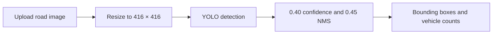

# YOLO Road Image Detector

I built this project to detect cars and trucks in uploaded road images. The app displays bounding boxes, class labels, confidence scores, and separate car and truck counts.

## Problem

Manually identifying vehicles in road images can be difficult, especially when roads are crowded or vehicles are distant, poorly lit, or partially blocked. My goal was to create a simple application that uses YOLO to locate and classify road vehicles automatically.

## Live Demo

**TBD — add the deployed app link here.**

## Architecture

My application processes an image using the following steps:

1. The user uploads a PNG or JPG road image.
2. The app preprocesses the image to **416 × 416 pixels**.
3. The YOLO model generates possible vehicle detections.
4. Detections below the **0.40 confidence threshold** are removed.
5. **Non-max suppression (NMS) at 0.45** removes overlapping duplicate boxes.
6. The app displays the final bounding boxes, labels, confidence scores, and car/truck counts.



Technology stack: **TBD**

## Suchet’s Contribution

**TBD — add only Suchet’s confirmed contribution based on project records or Git history.**

## Setup

The exact dependencies and commands must be confirmed from the repository.

```bash
# Clone the repository
git clone TBD
cd TBD

# Install dependencies
TBD

# Add or download the required model files
TBD

# Run the application
TBD
```

## Screenshots

### Upload Screen

**TBD — add a screenshot of the image uploader and limitations notice.**

### Detection Results

**TBD — add a screenshot showing bounding boxes, confidence scores, and car/truck counts.**

## Testing

I plan to evaluate the detector with **10–20 legally usable road images** covering daylight, crowded roads, low light, occlusion, distant vehicles, and unusual camera angles. I will record the expected vehicles before running the model and will not invent or pre-fill results.

| Image | Condition        | Expected Vehicles | Detected Cars | Detected Trucks | False Positives | Missed Vehicles | Confidence Notes | Observations |
| ----: | ---------------- | ----------------: | ------------: | --------------: | --------------: | --------------: | ---------------- | ------------ |
|     1 | Daylight         |                   |               |                 |                 |                 |                  |              |
|     2 | Crowded road     |                   |               |                 |                 |                 |                  |              |
|     3 | Low light        |                   |               |                 |                 |                 |                  |              |
|     4 | Occlusion        |                   |               |                 |                 |                 |                  |              |
|     5 | Distant vehicles |                   |               |                 |                 |                 |                  |              |
|     6 | Unusual angle    |                   |               |                 |                 |                 |                  |              |

Test results and automated testing commands: **TBD**

## Limitations

My detector may be affected by:

* Dark, blurry, low-resolution, or overexposed images
* Vehicles that are far away or partially blocked
* Crowded scenes with overlapping vehicles
* Unusual camera angles
* False positives, missed vehicles, or incorrect classifications

Verified accuracy, speed, and hardware-performance measurements are **TBD**. This is an educational project and should not be used for safety-critical driving decisions.

## Model and Data Attribution

* YOLO version: **TBD**
* Model weights and source: **TBD**
* Training or fine-tuning dataset: **TBD**
* Evaluation-image sources: **TBD**
* Model, code, dataset, and image licences: **TBD**

I will verify all licences and usage requirements before redistributing any model weights, datasets, or evaluation images.

## AI-Assistance Acknowledgement

I used generative AI to help brainstorm the app’s presentation, upload constraints, detector explanation, evaluation plan, and README wording.

AI-assisted code, along with how I reviewed, tested, or modified it: **TBD**

All personal contributions should be credited only to the people who completed and verified them.

## Next Steps

* Add the live demo and screenshots
* Confirm the technology stack and setup instructions
* Document Suchet’s verified contribution
* Test the detector on 10–20 legally usable images
* Report the results without inventing performance metrics
* Add automated tests for uploads, errors, zero detections, and vehicle counts
* Verify and document all model, code, dataset, and image licences
